<p align="center">
  <h1 align="center">MAXIMUS</h1>
  <p align="center"><strong>The AI Brain That Thinks Like an Application Security Tester</strong></p>
  <p align="center">Full-stack autonomous penetration testing powered by LLMs</p>
</p>

<p align="center">
  
  
  
  
  
  
  
</p>

---

MAXIMUS is an AI-driven autonomous penetration testing platform. It uses LLMs (Claude, GPT-4, Kimi, Qwen) to **plan**, **execute**, and **document** a complete web application security assessment end-to-end — with zero manual intervention.

The AI agent runs real security tools inside an isolated Docker container, auto-scores every vulnerability with CVSS 4.0, and generates a professional PDF pentest report with one click.

---

## Screenshots & POC

### Starting MAXIMUS — All Services Up and Running
<p align="center">
  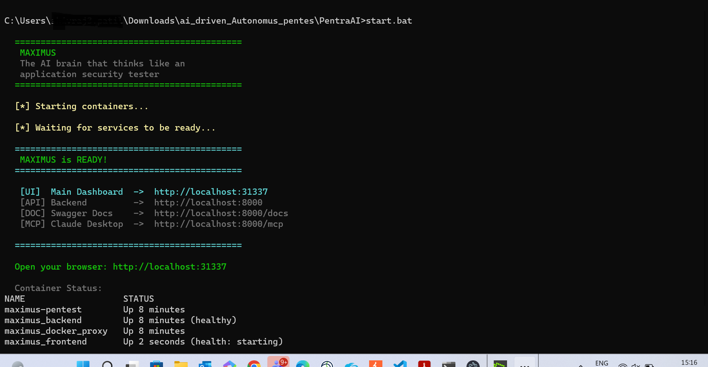
</p>

### Login Page
<p align="center">
  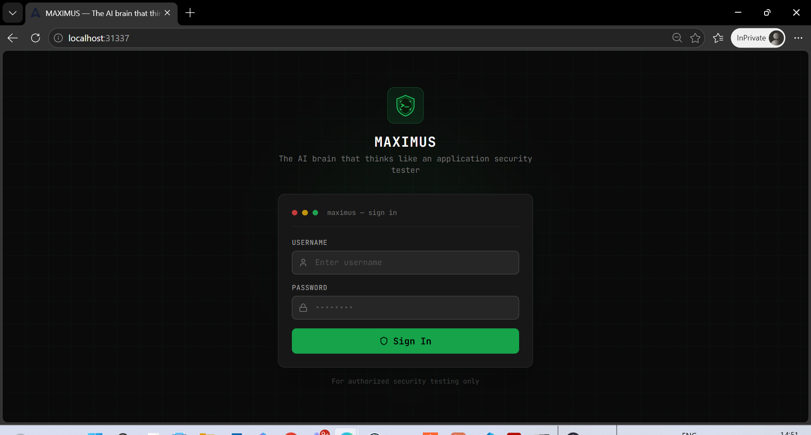
</p>

### Dashboard — Real-Time Security Assessment Analytics
<p align="center">
  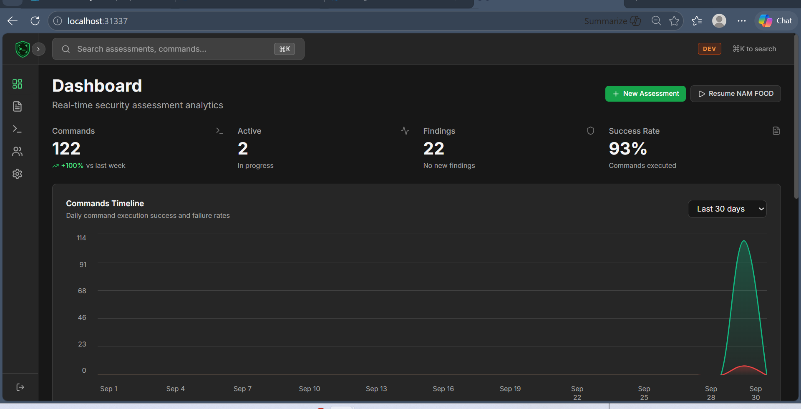
</p>

### Assessment Templates — Web App, API, Infrastructure, Mobile, AD, OWASP ASVS
<p align="center">
  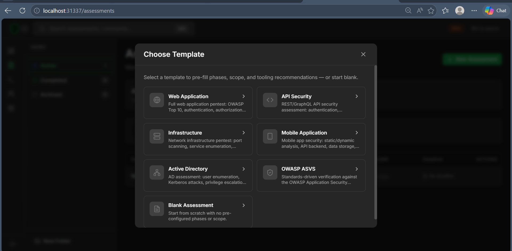
</p>

### Create Assessment — Define Target, Scope & Objectives
<p align="center">
  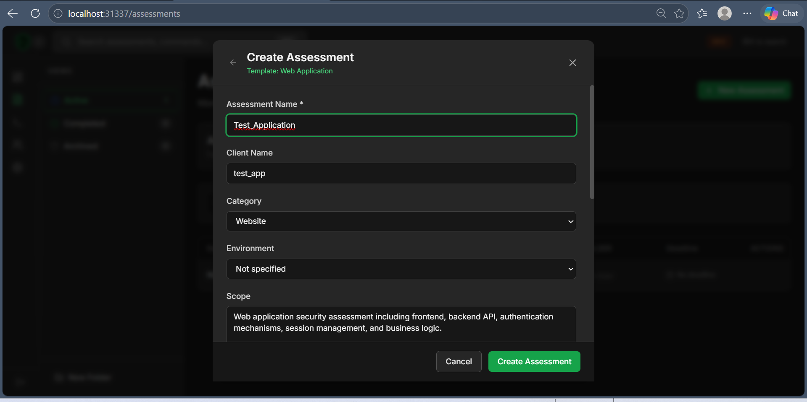
</p>
<p align="center">
  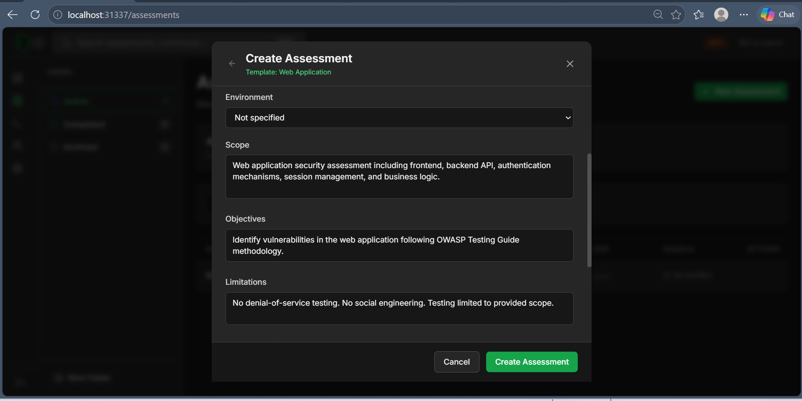
</p>

### Target Domains & IP Scopes Configuration
<p align="center">
  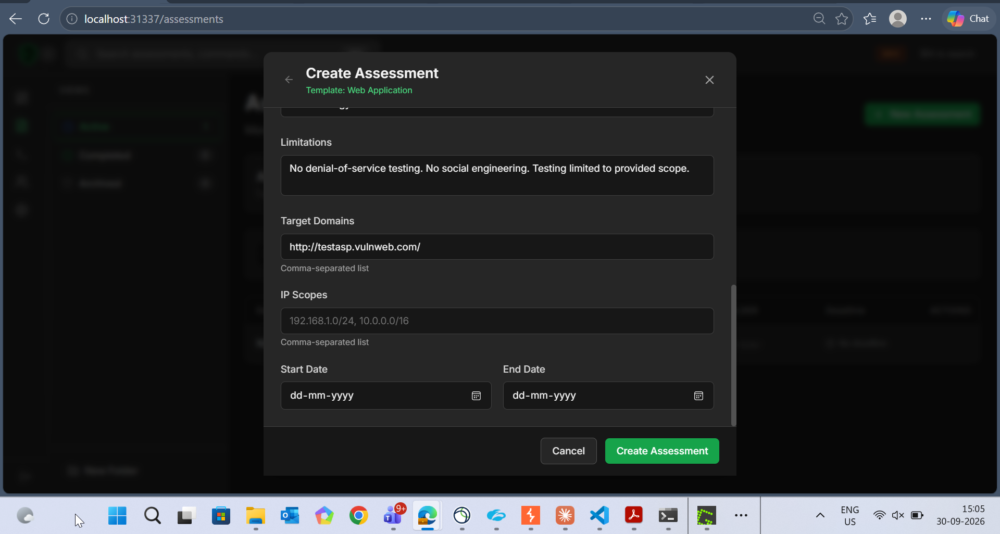
</p>

### Context Documents — Upload Walkthroughs, API Collections & Source Code
<p align="center">
  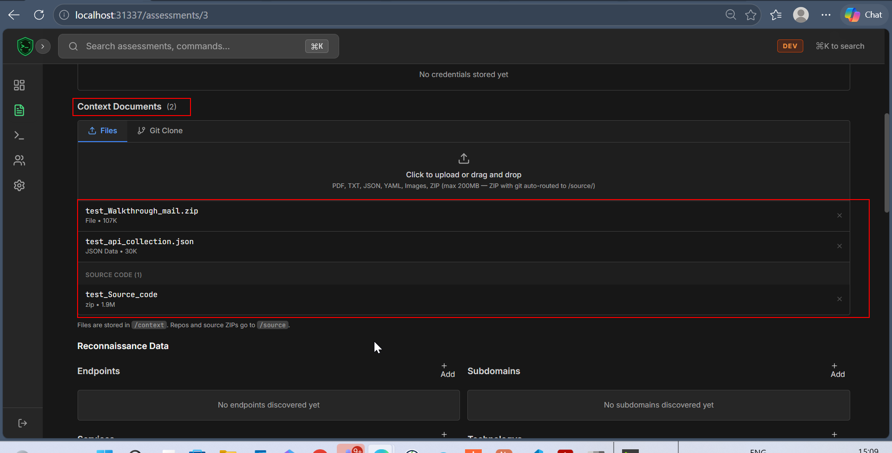
</p>

### Credentials Manager — Store & Auto-Inject Credentials via Placeholders
<p align="center">
  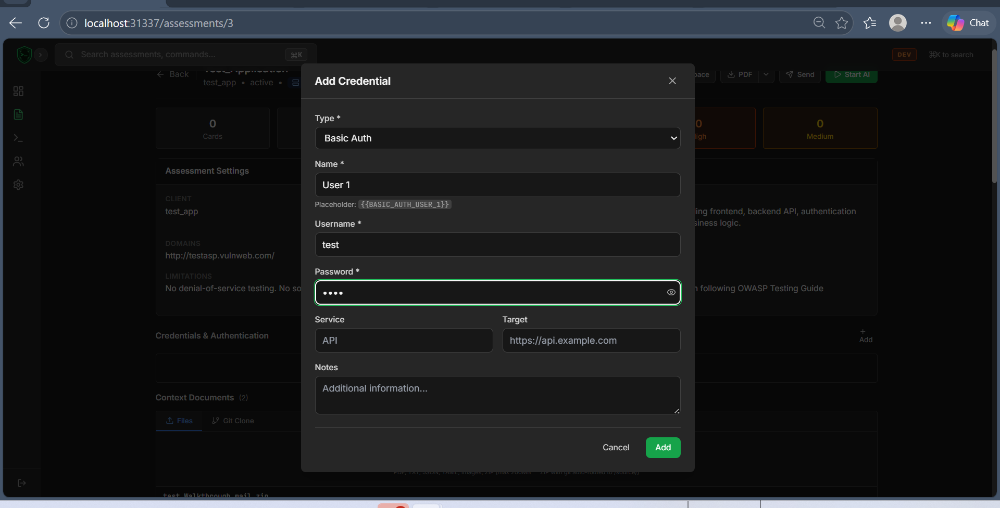
</p>

### Claude Desktop MCP Integration — MAXIMUS Running as MCP Server
<p align="center">
  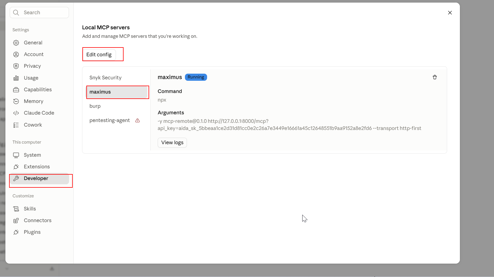
</p>

### AI Describing Available MCP Tools
<p align="center">
  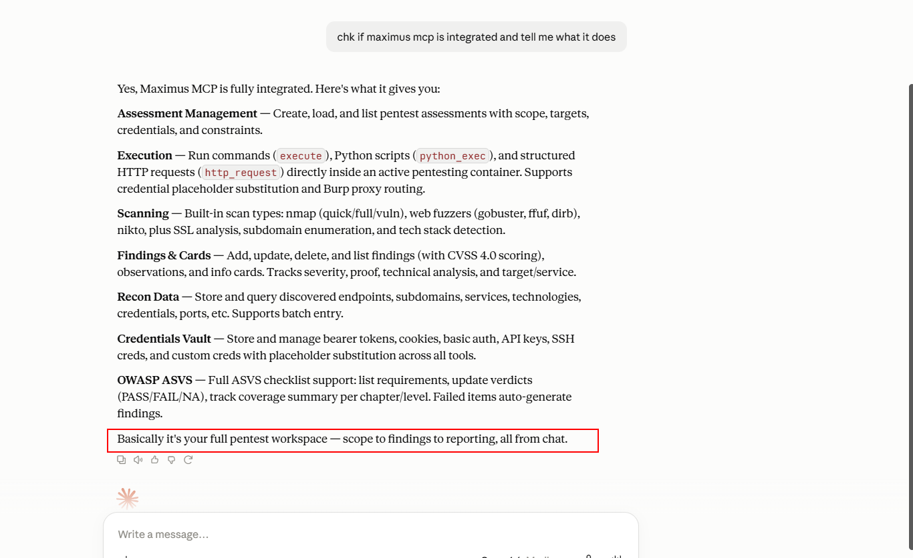
</p>

### AI Agent Executing Autonomous Pentest — Phase 1: Reconnaissance
<p align="center">
  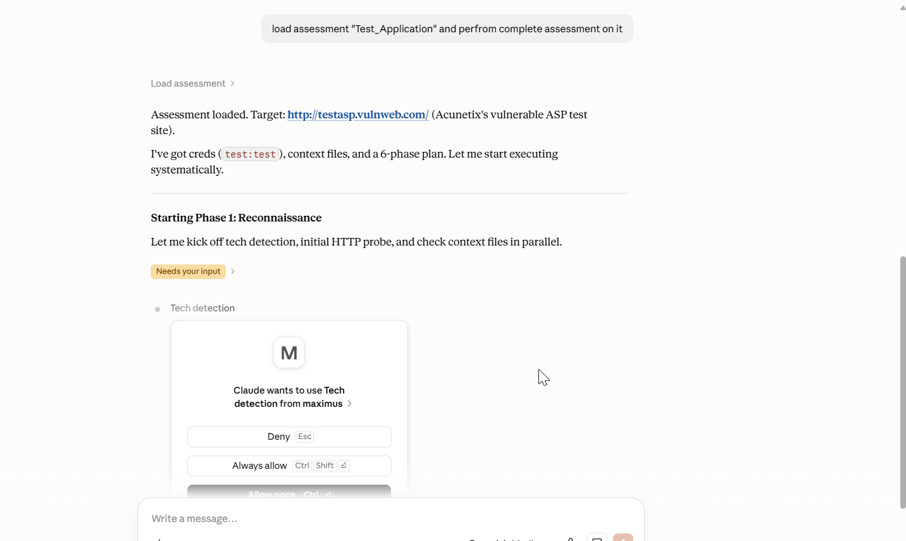
</p>

### Cards & Findings — Vulnerabilities Discovered with CVSS 4.0 Scores
<p align="center">
  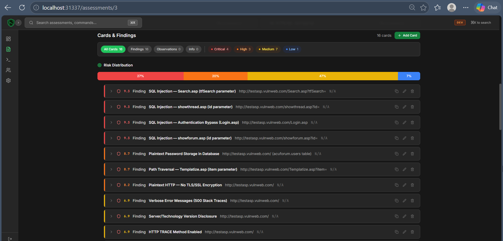
</p>

### Assessment Overview — PDF Export, Stats & Credential Management
<p align="center">
  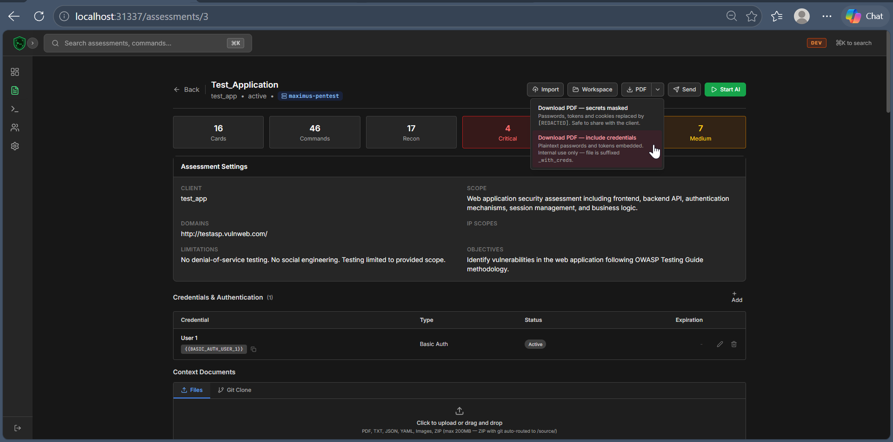
</p>

---

## How It Works

```
You define the target
        |
        v
   AI plans the attack strategy
        |
        v
   Executes 14+ security tools autonomously
   (nmap, sqlmap, ffuf, nuclei, hydra, subfinder ...)
        |
        v
   Logs every finding with CVSS 4.0 scores
        |
        v
   Generates a full PDF pentest report
```

No manual intervention required. The AI handles reconnaissance, mapping, vulnerability assessment, and exploitation — all inside a sandboxed container.

---

## Key Features

| Feature | Description |
|---------|-------------|
| **Autonomous AI Agent** | Claude / GPT-4 / Kimi / Qwen drives the full pentest lifecycle |
| **MCP Integration** | Use MAXIMUS as a tool inside Claude Desktop or Cursor IDE |
| **Web Dashboard** | React UI with real-time WebSocket updates |
| **14+ Security Tools** | nmap, sqlmap, ffuf, nuclei, hydra, subfinder, nikto, gobuster + SecLists |
| **CVSS 4.0 Auto-Scoring** | Every vulnerability is auto-scored on discovery |
| **PDF Reports** | One-click professional pentest report export |
| **Pro Tools** | CVE Lookup (NVD API), JS Secret Scanner (30+ patterns), Scope Manager |
| **Scope Enforcement** | Hard-block mechanism prevents testing out-of-scope targets |
| **JWT Auth** | Secure login, API keys, admin/user roles |
| **ASVS Methodology** | Optional OWASP ASVS-based assessment mode |
| **Multi-AI CLI** | Works with Claude Code, OpenAI Codex, Kimi Code, Qwen Code |
| **Command Approval** | Review and approve/reject commands before execution |
| **Real-Time Updates** | WebSocket-powered live dashboard |

---

## Architecture

```
┌───────────────────────────────────────────────────────────────┐
│                          MAXIMUS                              │
│                                                               │
│  ┌──────────────┐   ┌──────────────┐   ┌──────────────────┐  │
│  │   React UI   │   │   FastAPI    │   │   MCP Server     │  │
│  │    :31337    │◄──│   Backend    │◄──│   HTTP /mcp      │◄───── Claude Desktop
│  │   (Nginx)    │   │    :8000     │   │   stdio mode     │◄───── Claude Code
│  └──────────────┘   └──────┬───────┘   └──────────────────┘  │
│                             │                                 │
│  ┌──────────────┐   ┌──────▼───────┐   ┌──────────────────┐  │
│  │  PostgreSQL  │   │ Docker Socket│   │ maximus-pentest   │  │
│  │    :5432     │   │    Proxy     │──▶│ nmap, sqlmap,     │  │
│  │              │   │  (filtered)  │   │ ffuf, nuclei ...  │  │
│  └──────────────┘   └──────────────┘   └──────────────────┘  │
└───────────────────────────────────────────────────────────────┘
```

**Network isolation:** The pentest container runs on a separate Docker network, completely isolated from the main infrastructure. The Docker Socket Proxy only allows container inspect and exec — no image, volume, network, or swarm operations.

---

## 4-Phase AI Methodology

### Phase 1 — Reconnaissance
- Port & service scanning (nmap)
- Tech stack fingerprinting (whatweb)
- Auto CVE lookup for every detected technology (NVD API v2.0)
- SSL/TLS auditing
- Subdomain enumeration (subfinder, dnsx)
- Certificate transparency search (crt.sh)

### Phase 2 — Mapping
- Directory & file discovery (ffuf, gobuster)
- API endpoint discovery
- Application crawling (katana)
- JavaScript collection + automatic secret scanning (30+ patterns)
- Parameter discovery (arjun)

### Phase 3 — Vulnerability Assessment
- SQL Injection, NoSQL Injection, SSTI, XXE, Command Injection
- Broken Authentication (weak passwords, JWT attacks, session fixation)
- Broken Access Control (IDOR, BOLA/BFLA, privilege escalation)
- XSS (reflected, stored, DOM-based)
- SSRF, CSRF, CORS misconfiguration
- File upload / LFI / RFI
- Business logic flaws (race conditions, price manipulation)

### Phase 4 — Exploitation
- Exploit confirmed vulnerabilities
- Credential chaining and lateral movement
- Extract proof-of-concept outputs
- Full documentation with exact commands and raw output

---

## Prerequisites

- **WSL 2** with Ubuntu (Windows users)
- **Docker Desktop** with WSL2 backend enabled
- **Python 3.10+**
- **Node.js 18+** (for dev mode or mcp-remote bridge)
- An AI CLI: [Claude Code](https://claude.com/claude-code), OpenAI Codex, Kimi Code, or Qwen Code

---

## Installation

> All commands must be run inside a **WSL Ubuntu** terminal.

### 1. Clone the repository

```bash
git clone https://github.com/YOUR_USERNAME/MAXIMUS.git
cd MAXIMUS
```

### 2. Run the one-command setup

```bash
chmod +x setup.sh start.sh stop.sh restart.sh
./setup.sh
```

This will:
- Create a Python virtual environment and install dependencies
- Pull required Docker images
- Generate `backend/.env` with a random secret key
- Build the frontend
- Start all services

### 3. Open the dashboard

```
http://localhost:31337
```

Create your **admin account** on the first-run setup wizard.

### 4. Launch the AI agent

```bash
source .venv/bin/activate
python3 maximus.py -a "your-assessment-name"
```

The AI will start the autonomous pentest session against the target you configured.

---

## CLI Usage

```bash
source .venv/bin/activate

# Run against an existing assessment
python3 maximus.py -a "target-corp"

# Auto-detect available AI CLI (Claude / GPT / Kimi / Qwen)
python3 maximus.py -a "target-corp" --cli auto

# Fully autonomous — skip all confirmation prompts
python3 maximus.py -a "target-corp" --yes

# Use a specific model
python3 maximus.py -a "target-corp" -m claude-opus-4-5

# Define scope inline
python3 maximus.py -a "target-corp" --scope "target.com,*.target.com,10.0.0.0/24"

# Force HTTP MCP transport
python3 maximus.py -a "target-corp" --http http://localhost:8000/mcp

# Generate Claude Desktop config
python3 maximus.py setup-desktop
```

---

## Claude Desktop Integration

### 1. Start MAXIMUS

```bash
./start.sh
```

### 2. Get an API key

Open `http://localhost:31337` → **Settings** → **API Keys** → **Create Key**

### 3. Generate config

```bash
source .venv/bin/activate
python3 maximus.py setup-desktop
```

### 4. Add to Claude Desktop

Add this to `%APPDATA%\Claude\claude_desktop_config.json`:

```json
{
  "mcpServers": {
    "maximus": {
      "url": "http://localhost:8000/mcp",
      "headers": {
        "Authorization": "Bearer YOUR_API_KEY"
      }
    }
  }
}
```

Restart Claude Desktop — **maximus** will appear in the tools panel.

---

## Cursor IDE Integration

```json
{
  "mcpServers": {
    "maximus": {
      "url": "http://localhost:8000/mcp",
      "headers": { "Authorization": "Bearer YOUR_API_KEY" }
    }
  }
}
```

---

## MCP Tools

These tools are exposed to the AI agent via the Model Context Protocol:

| Tool | Description |
|------|-------------|
| `execute()` | Run any shell command in the pentest container |
| `scan()` | Port scan, web fuzzing, vulnerability scan |
| `subdomain_enum()` | Discover subdomains (subfinder, amass) |
| `ssl_analysis()` | Audit TLS/SSL configuration |
| `tech_detection()` | Fingerprint web technologies |
| `python_exec()` | Execute Python scripts in the container |
| `http_request()` | Make HTTP requests with credential auto-injection |
| `add_card()` | Log a vulnerability finding (CVSS 4.0 auto-scored) |
| `credentials_add()` | Store discovered credentials |
| `create_assessment()` | Create a new pentest assessment |
| `load_assessment()` | Load an existing assessment |
| `list_assessments()` | List all assessments |
| `add_recon_data()` | Store reconnaissance findings |

---

## Pro Tools

Built-in security utilities accessible via the web dashboard and REST API:

### CVE Lookup
Queries the NVD API v2.0 for known CVEs matching any technology + version. Supports severity filtering and bulk scan.

### JavaScript Secret Scanner
Scans JS files (URL, file, or raw content) for 30+ secret patterns — AWS keys, GitHub PATs, Stripe keys, JWT tokens, database URIs, private keys, hardcoded credentials, internal endpoints, and more.

### Scope Manager
Defines and validates targets against scope definitions. Supports exact match, wildcard domains (`*.target.com`), CIDR notation, and explicit out-of-scope entries with a default-deny policy.

---

## Services & Ports

| Service | URL | Description |
|---------|-----|-------------|
| Dashboard | `http://localhost:31337` | Web UI (production) |
| Dashboard (dev) | `http://localhost:5173` | Web UI with Vite hot reload |
| Backend API | `http://localhost:8000` | FastAPI REST API |
| API Docs | `http://localhost:8000/docs` | OpenAPI / Swagger |
| MCP Endpoint | `http://localhost:8000/mcp` | Model Context Protocol server |
| PostgreSQL | `localhost:5432` | Database |

---

## Shell Scripts

| Script | Purpose |
|--------|---------|
| `./setup.sh` | One-time setup (run once after clone) |
| `./start.sh` | Start all services |
| `./start.sh --dev` | Dev mode with Vite hot reload |
| `./start.sh --lan` | LAN mode with HTTPS |
| `./stop.sh` | Stop all services (data preserved) |
| `./restart.sh` | Restart all services |

Windows users can use `start.bat` or `start.ps1`.

---

## Project Structure

```
MAXIMUS/
├── maximus.py                     # AI CLI launcher
├── docker-compose.yml             # Core 5-service infrastructure
├── docker-compose.prod.yml        # Nginx production overlay
├── requirements.txt               # Python dependencies
├── setup.sh / start.sh / stop.sh  # Service lifecycle
│
├── backend/
│   ├── maximus_main.py            # FastAPI app + MCP server
│   ├── api/
│   │   └── pro_tools.py           # CVE Lookup, JS Scanner, Scope Manager
│   ├── report_service.py          # PDF report generator
│   ├── report_templates/          # Jinja2 report templates + CSS
│   └── .env.example               # Environment config template
│
├── frontend/
│   ├── src/
│   │   ├── pages/                 # Dashboard, Assessments, Commands, Settings, ProTools
│   │   ├── components/            # CVSS Calculator, Timeline, ReconTable, AsvsGrid
│   │   ├── contexts/              # Auth, WebSocket, Theme, PendingCommands
│   │   └── services/              # API clients
│   ├── nginx.conf                 # Production reverse proxy config
│   └── package.json
│
├── tools/
│   ├── cve_lookup.py              # Standalone CVE lookup tool
│   ├── js_scanner.py              # Standalone JS secret scanner
│   └── scope_check.py             # Scope enforcer with hard-block
│
└── Docs/
    ├── PrePrompt.txt              # AI system prompt (4-phase methodology)
    └── PrePrompt-ASVS.txt         # OWASP ASVS methodology prompt
```

---

## Tech Stack

| Layer | Technology |
|-------|-----------|
| **Backend** | Python 3.10, FastAPI, PostgreSQL 16, WebSockets, Uvicorn |
| **Frontend** | React 19, Vite 8, Tailwind CSS 3, Nginx |
| **AI** | Anthropic MCP, Claude, GPT-4, Kimi, Qwen |
| **Security Tools** | nmap, sqlmap, ffuf, nuclei, hydra, subfinder, nikto, gobuster, katana, arjun |
| **Reports** | Jinja2, WeasyPrint (HTML → PDF) |
| **Infrastructure** | Docker, Docker Compose, WSL 2 |

---

## Security & Legal Notice

> **This tool is for authorized security testing only.**

- Always obtain **written permission** before testing any target
- Never expose the dashboard to the internet without TLS
- The Docker Socket Proxy restricts container access to exec/inspect only
- Change `POSTGRES_PASSWORD` and `SECRET_KEY` in `backend/.env` before production use
- Unauthorized use against systems you do not own is **illegal**

---

## Credits

- [AIDA by Vasco0x4](https://github.com/vasco0x4/aida) — Backend, frontend, and MCP server base
- [Anthropic MCP](https://modelcontextprotocol.io/) — Model Context Protocol
- [aida-pentest container](https://hub.docker.com/r/vasco0x4/aida-pentest) — Pre-built pentest environment with 14+ tools
